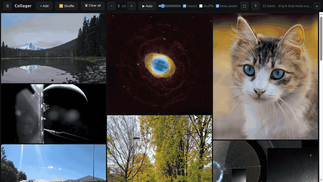

# Collager

A desktop media collage viewer for Linux, Windows and macOS. Drop in images
(PNG/JPEG/WebP), GIFs and videos (MP4/WebM) and see them all together as one
scrollable, tightly packed collage. GIFs and videos loop forever; videos are
muted.



<sub>Demo media: public-domain images and video from the NASA image library, plus CC0
photos from Wikimedia Commons.</sub>

## Install

Download the latest installer from the
[releases page](https://github.com/sheijningen/collager/releases/latest):

- **Linux**: `Collager-<version>-linux-x86_64.AppImage`. Make it executable
  (`chmod +x`) and run it.
- **Windows**: `Collager-<version>-windows-x64-setup.exe`. It installs Collager for
  the current user, on the Desktop and in the Start menu.
- **macOS**: `Collager-<version>-macos-arm64.dmg` for Apple silicon,
  `Collager-<version>-macos-x64.dmg` for Intel Macs. Open it and drag Collager into
  Applications.

  Collager is signed ad hoc, not with an Apple Developer ID, so macOS warns about an
  unidentified developer and blocks the first start. Control-click (or right-click)
  Collager in Applications, pick **Open** and confirm. On macOS 15 and later
  that dialog has no Open button: start the app once, then click **Open Anyway** under
  **System Settings > Privacy & Security**. If macOS says the app is damaged, or either
  way fails, clear the quarantine flag in Terminal instead:

  ```bash
  xattr -d com.apple.quarantine /Applications/Collager.app
  ```

Every release also carries a `SHA256SUMS` file; `sha256sum -c SHA256SUMS` in the download
folder checks the installers against it (`shasum -a 256 -c SHA256SUMS` on macOS).

## Usage

- **About**: click the "Collager" title at the left of the toolbar, or press I.
- **Add media**: pick **Add media files** or **Add a folder** from the
  **Files ▾** menu, or drag and drop files or folders anywhere in the window
  (folders are scanned recursively). On macOS they can also be dropped on the
  Dock icon.
- **File panel**: **Files ▾** also toggles a sidebar listing every file,
  sortable in different ways. Clicking an entry scrolls to it.
- **Collage menu**: **Collage ▾** holds **Shuffle**, which re-shuffles and
  re-packs the collage, the **Columns** stepper (1 to 8), and **Clear all**,
  which removes every item after confirmation.
- **Auto-scroll**: **Scroll ▾** holds **Start auto-scroll**, which scrolls the
  collage continuously, and its settings: the speed slider,
  **Restart at the end** to carry on seamlessly from the top, **Shuffle on restart**, and
  **Keep the display awake** while it runs.
- **Fullscreen**: the ⛶ button at the right of the toolbar, or F11 (Ctrl+Cmd+F
  on macOS).
- **Toolbar**: the chevron in the top-right corner hides and shows the toolbar.
  With fullscreen and auto-scroll this gives a clean kiosk or wall mode.
- **Reorder**: drag a tile onto another tile to move it there.
- **Maximize**: double-click a tile to view it enlarged.

Press **?** or F1 in the app for the full list of keyboard shortcuts.

Collager stores the collage and your settings in `~/.config/collager` on Linux,
`%APPDATA%\collager` on Windows and `~/Library/Application Support/collager` on macOS.

## Development

Requires [pnpm](https://pnpm.io/installation).

```bash
pnpm install
pnpm start          # run from source
pnpm test           # unit tests
pnpm test:e2e       # boots the real app; needs a display
pnpm lint           # eslint
pnpm format         # prettier
```

Installers can be built locally too:

```bash
pnpm dist:linux   # AppImage
pnpm dist:win     # NSIS installer
pnpm dist:mac     # DMGs for Intel and Apple silicon; needs a Mac
```

Architecture, design decisions and conventions are in [CLAUDE.md](CLAUDE.md).

## License

[Apache 2.0](LICENSE), © Stefan Alexander van Heijningen.
